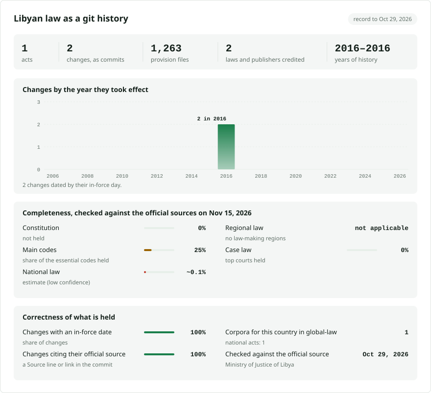

# Libya: law history in git

[العربية](README.md) · **English**

<picture>
<source media="(prefers-color-scheme: dark)" srcset="data/effort-dark.svg">

</picture>

The law of Libya as a git history: one file per article, one commit per version on the day it took effect, and the act that made each change as the commit's author. `git blame` names the act behind every article; `git log` lists every change to an article; picking a date gives the text in force that day.

Part of [lexifina/global-law](https://github.com/lexifina/global-law), one git history for every country's law: this is Libya's national law, which global-law reads at `libya/national/acts/`.

**What is in it now:** about 2,050 texts from 1948 to 2020: the Constitutional Declaration of 2011 with its amendments and the earlier constitutions, 635 laws, 1,149 decisions, 208 parliamentary decisions, executive regulations and agreements, and the Civil Code of 1953 in two versions. The Penal Code and the procedure codes are not here yet. [`STRUCTURE.md`](STRUCTURE.md) gives the layout; [`REPRODUCE.md`](REPRODUCE.md) says how the files were made.

Folders are named in Arabic, by type and year: `قوانين/<year>/<number>-<subject>/` for laws, `قرارات/` for decisions, `الإعلان-الدستوري/` for the Constitutional Declaration. Each article is one file (`مادة-001.md`); `ديباجة.md` holds the title and preamble. The Civil Code is in `قوانين/1953/القانون-المدني/`, its articles in folders of 500 (`مواد-0001-0500/مادة-0001.md`).

The text is in Arabic, the official language. An English translation is not part of this record.

## Questions as git commands

| Question | Command |
| --- | --- |
| Every change to Article 1 of the Civil Code | `git log --follow -p --word-diff -- قوانين/1953/القانون-المدني/مواد-0001-0500/مادة-0001.md` |
| Which act wrote each line of Article 1? | `git blame قوانين/1953/القانون-المدني/مواد-0001-0500/مادة-0001.md` |
| Every text of the Constitutional Declaration and its amendments | `git log --format="%h %(trailers:key=In-force,valueonly,separator=) %an %s" -- الإعلان-الدستوري نصوص-دستورية` |
| Every law of 2013 | `git log --format="%h %(trailers:key=In-force,valueonly,separator=) %s" -- قوانين/2013` |

**Outside git**, we also host this record publicly, for free:

- **[Ask Claude about Libyan law](https://global-law.lexifina.com/v1/try_claude?country=libya)**: opens Claude with a first question ready.
- **[Ask ChatGPT](https://global-law.lexifina.com/v1/try_chatgpt?country=libya)**: the same question in ChatGPT.
- **[Search Libyan law on our site](https://lexifina.com/law?country=libya&q=%D8%B9%D9%82%D8%AF+%D8%A7%D9%84%D8%A8%D9%8A%D8%B9)**: a search for "عقد البيع" (contract of sale), with each provision's text and its versions, no account needed.
- **[Developer REST API](https://global-law.lexifina.com/v1/search_law?query=%D8%B9%D9%82%D8%AF+%D8%A7%D9%84%D8%A8%D9%8A%D8%B9&jurisdiction=libya)**: the same search as JSON, with no key. See the [documentation here](https://lexifina.com/api/global-law).

Both assistants read the record through the free Global law connector (MCP, `https://global-law.lexifina.com/mcp`); the first time, the chat gives you the link that adds it. Ask in Arabic or in English.

**Host it yourself easily.** All it takes is git and Python, and the tools run on your machine:

```sh
git clone --depth 1 https://github.com/lexifina/global-law && cd global-law
python3 tools/countries.py add libya/national/acts
python3 tools/law.py show 2026-01-01 libya/national/acts/الإعلان-الدستوري/مادة-001.md
```

Opened in Claude Code, Cursor, VS Code or Codex, the clone also starts a local MCP server with the same tools ([MCP.md](https://github.com/lexifina/global-law/blob/main/MCP.md)).

## Dates

Each commit is dated at noon, Africa/Tripoli, on the day the version took effect, and carries it in its `In-force:` trailer:

- the first version is dated 18 January 2016, the day before Law No. 6 of 2016 took effect. The Ministry's volume does not say when that text took effect: the Code was promulgated on 28 November 1953 and published on 20 February 1954, and the text already includes its amendments to 2015. A date before 18 January 2016 gives no text;
- Law No. 6 of 2016 of the General National Congress took effect on its day of issue, 19 January 2016 (its article 4). It replaced 60 articles (two of them, 515 and 1052, with unchanged words), added Article 290 bis and repealed 16 articles, whose files are removed from that day.

The first version is credited to the publisher, the Ministry of Justice of Libya, as the "oldest version available" (`Kind: publisher`), and the changes of 19 January 2016 to Law No. 6 of 2016. The committer is Lexifina.

Every other text is dated by the day it was made (DCAF's field "تاريخ النص"), and is credited to the body that made it; its `In-force-basis:` trailer says whether the text applies from that day or from a later day the source does not give (often its publication in the Official Gazette). Before 1970 the commit date is 1 January 1970 and the real day starts the subject. The consolidated Constitutional Declaration is dated by the newest amendment the source links to it (6 August 2014). Texts whose day cannot be read, or whose day disagrees with the year in their title, are held.

## How it is checked

- `tools/check_repo.py` reads every version back from git on the day it took effect and on the day before and compares it with the corpus, whose hash is in `data/corpus.sha256`; it also checks that every commit's trailers parse, that `main` has no merge commits and that no commit is dated in the future.
- `tools/build.py` writes the history from that one corpus file, and the same corpus gives the same commit hashes. [`REPRODUCE.md`](REPRODUCE.md) records that the checks were not yet run for this build and that no second build has been compared.
- The sha256 of the PDF both versions were read from is in `data/versions.json`, and every decision made by hand (such as Article 870, which the PDF misprints as 780) is in [`REPRODUCE.md`](REPRODUCE.md).
- [vulnerabilities/](vulnerabilities/README.en.md): possible drafting mistakes in this law, found by global-law's detectors and checked by hand. Not run yet.

## What it does not show

- **Earlier versions of the Code.** It was amended many times from 1954; those texts are not online in one place, and none is here.
- **The Penal Code, the procedure codes and the Commercial Code.** The source's texts of these codes do not say which state of the code they show, so they are held. Nor is the Official Gazette here, or the amendments to the Constitutional Declaration after 2014.
- **Most texts outside the security and justice sector.** The DCAF database covers the security sector (police, courts, armed forces, oversight bodies) and the constitutional texts; other laws are here only where it carries them.
- **Footnotes and page numbers** of the Ministry's PDF.
- **An official text.** The Civil Code comes from the PDF's own text layer, without OCR (some words keep stray spaces); the other texts are DCAF's unofficial transcriptions. For anything that matters, read the original in the Official Gazette.

## Sources

| Source | Kind | Past versions | Notes |
| --- | --- | --- | --- |
| [Ministry of Justice of Libya](https://aladel.gov.ly/home/%d8%a7%d9%84%d9%82%d8%a7%d9%86%d9%88%d9%86-%d8%a7%d9%84%d9%85%d8%af%d9%86%d9%8a-%d9%88%d8%a7%d9%84%d9%85%d9%84%d8%ad%d9%82-%d8%a7%d9%84%d9%85%d8%b9%d8%af%d9%84-%d8%a7%d9%84%d8%ac%d8%b2%d8%a1-%d8%a7/) (aladel.gov.ly) | Official legislation: the Civil Code volume (PDF, 14 April 2016) | the Code before Law No. 6 of 2016, then that law's text | Both versions; retrieved on 29 October 2026 |
| [DCAF Libya Security Sector Legal Database](https://security-legislation.ly/ar/) (security-legislation.ly) | Unofficial transcriptions of laws, decisions, regulations, constitutional texts and agreements, in Arabic | each text as made; the Constitutional Declaration as amended | About 2,050 texts; retrieved on 26 November 2026 |

## Licence

See [`LICENSE`](LICENSE). The texts are official texts of the State of Libya. The Ministry of Justice and DCAF show only a general "all rights reserved" footer and state no terms of reuse; DCAF marks its texts as unofficial transcriptions. Lexifina's history, commit messages, tables and tools are CC0 1.0.

No AI model wrote, translated or corrected legal text, and none runs when the history is built; the scripts were written by an AI model (see [`REPRODUCE.md`](REPRODUCE.md)).

## Visualisations

- [visualisations/](visualisations/README.en.md): charts drawn from this repository. Not drawn yet.

## More

From [lexifina/global-law](https://github.com/lexifina/global-law):

- [FEATURES.md](https://github.com/lexifina/global-law/blob/main/FEATURES.md): every feature, and what every corpus must support (`git blame`, `law.py`, the MCP tools)
- [FAQ.md](https://github.com/lexifina/global-law/blob/main/FAQ.md): questions and answers · [CONTRIBUTING.md](https://github.com/lexifina/global-law/blob/main/CONTRIBUTING.md): proposing changes · [MCP.md](https://github.com/lexifina/global-law/blob/main/MCP.md): the MCP server · [REPRODUCE.md](https://github.com/lexifina/global-law/blob/main/REPRODUCE.md): how it was built · [CHANGELOG.md](https://github.com/lexifina/global-law/blob/main/CHANGELOG.md)
- [FRESHNESS.md](https://github.com/lexifina/global-law/blob/main/FRESHNESS.md): how current each corpus is · [Monitoring](https://github.com/lexifina/global-law/tree/main/monitoring): whether updates are running · [WATCHING.md](https://github.com/lexifina/global-law/blob/main/WATCHING.md): how each official source is watched for changes
- [performance/](https://github.com/lexifina/global-law/tree/main/performance): how fast the tools are, measured
- [visualisations/](https://github.com/lexifina/global-law/tree/main/visualisations): charts and bridges across the world's law
- [Vulnerabilities](https://github.com/lexifina/global-law/tree/main/vulnerabilities): mistakes in legislation as published
