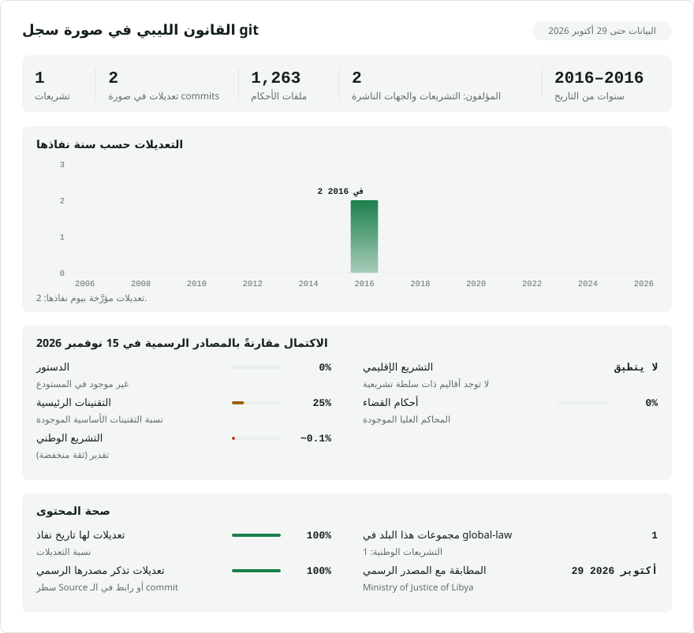

# ليبيا: تاريخ القانون في git

**العربية** · [English](README.en.md)

<picture>
<source media="(prefers-color-scheme: dark)" srcset="data/ar/effort-dark.svg">

</picture>

القانون الليبي في صورة سجل git: ملف لكل مادة، ولكل نسخة commit واحد في يوم نفاذها، والتشريع الذي أجرى كل تعديل هو مؤلف الـ commit. يبيّن `git blame` التشريع الذي يقف وراء كل مادة؛ ويسرد `git log` كل تعديل طرأ على مادة؛ واختيار تاريخ ما يعطي النص النافذ في ذلك اليوم.

جزء من [lexifina/global-law](https://github.com/lexifina/global-law)، وهو سجل git واحد لقانون كل بلد: هذا هو القانون الوطني الليبي، الذي يقرؤه global-law في `libya/national/acts/`.

**المحتوى الحالي:** تشريع واحد، القانون المدني لسنة 1953، في نسختين: كما تطبعه وزارة العدل قبل القانون رقم 6 لسنة 2016 (1151 مادة)، وكما أصبح بعد ذلك القانون في 19 يناير 2016 (1136 مادة). ولا يوجد هنا حتى الآن أي تشريع آخر. يسرد [`civil-code/README.md`](civil-code/README.md) كل مادة؛ ويبيّن [`REPRODUCE.md`](REPRODUCE.md) كيف أُعدّت الملفات.

كل مادة ملف واحد في `civil-code/`: `civil-code/art-0001.md` هي المادة 1 و`civil-code/art-0290-bis.md` هي المادة 290 مكرر. وكل عنوان (كتاب، باب، فصل، فرع) ملف `sec-*.md` يحمل اسم المادة التي يسبقها (`civil-code/sec-0006.md`).

النص باللغة العربية، وهي اللغة الرسمية، كما يطبعه ملف PDF الصادر عن الوزارة. والترجمة الإنجليزية ليست جزءًا من هذا السجل.

## الأسئلة في صورة أوامر git

| السؤال | الأمر |
| --- | --- |
| كل تعديل طرأ على المادة 1 من القانون المدني | `git log -p --word-diff -- civil-code/art-0001.md` |
| أي تشريع كتب كل سطر من المادة 1؟ | `git blame civil-code/art-0001.md` |
| كل نسخ القانون المدني، مع يوم نفاذ كل منها | `git log --format="%h %(trailers:key=In-force,valueonly,separator=) %an" -- civil-code ":^civil-code/README.md"` |
| المادة 1 كما كانت نافذة في 18 يناير 2016، قبل القانون رقم 6 لسنة 2016 | `python tools/on.py 2016-01-18 civil-code art-0001` |

**خارج git**، نستضيف هذا السجل أيضًا للعموم، مجانًا:

- **[اسأل Claude عن القانون الليبي](https://global-law.lexifina.com/v1/try_claude?country=libya)**: يفتح Claude ومعه سؤال أول جاهز.
- **[اسأل ChatGPT](https://global-law.lexifina.com/v1/try_chatgpt?country=libya)**: السؤال نفسه في ChatGPT.
- **[ابحث في القانون الليبي على موقعنا](https://lexifina.com/law?country=libya&q=%D8%B9%D9%82%D8%AF+%D8%A7%D9%84%D8%A8%D9%8A%D8%B9)**: بحث عن "عقد البيع"، مع نص كل حكم ونسخه، دون الحاجة إلى حساب.
- **[واجهة REST API للمطوّرين](https://global-law.lexifina.com/v1/search_law?query=%D8%B9%D9%82%D8%AF+%D8%A7%D9%84%D8%A8%D9%8A%D8%B9&jurisdiction=libya)**: البحث نفسه بصيغة JSON، دون مفتاح. انظر [التوثيق هنا](https://lexifina.com/api/global-law).

يقرأ المساعدان كلاهما السجل عبر موصِّل Global law المجاني (MCP، `https://global-law.lexifina.com/mcp`)؛ وفي المرة الأولى تعطيك المحادثة الرابط الذي يضيفه. اسأل بالعربية أو بالإنجليزية.

**استضفه بنفسك بسهولة.** كل ما يلزم هو git وPython، والأدوات تعمل على جهازك:

```sh
git clone --depth 1 https://github.com/lexifina/global-law && cd global-law
python3 tools/countries.py add libya/national/acts
python3 tools/law.py show 2026-01-01 libya/national/acts/civil-code/art-0001.md
```

عند فتح النسخة المستنسخة في Claude Code أو Cursor أو VS Code أو Codex، تشغّل أيضًا خادم MCP محليًا بالأدوات نفسها ([MCP.md](https://github.com/lexifina/global-law/blob/main/MCP.md)).

## التواريخ

يحمل كل commit تاريخ الظهيرة، بتوقيت Africa/Tripoli، من اليوم الذي نفذت فيه النسخة، ويحمل هذا اليوم في تذييله (trailer) `In-force:`:

- تحمل النسخة الأولى تاريخ 18 يناير 2016، وهو اليوم السابق لنفاذ القانون رقم 6 لسنة 2016. ولا يذكر مجلد الوزارة متى نفذ ذلك النص: فقد صدر القانون في 28 نوفمبر 1953 ونُشر في 20 فبراير 1954، والنص يتضمن أصلًا تعديلاته حتى 2015. أي تاريخ قبل 18 يناير 2016 لا يعطي نصًا؛
- نفذ القانون رقم 6 لسنة 2016 الصادر عن المؤتمر الوطني العام من تاريخ صدوره، 19 يناير 2016 (مادته 4). وقد استبدل 60 مادة (اثنتان منها، 515 و1052، دون تغيير في ألفاظهما)، وأضاف المادة 290 مكرر وألغى 16 مادة، تُحذف ملفاتها اعتبارًا من ذلك اليوم.

تُنسب النسخة الأولى إلى الجهة الناشرة، وزارة العدل الليبية، بوصفها "أقدم نسخة متاحة" (`Kind: publisher`)، وتُنسب تعديلات 19 يناير 2016 إلى القانون رقم 6 لسنة 2016. والمُودِع (committer) هو Lexifina.

## كيف يُتحقَّق منه

- يعيد `tools/check_repo.py` قراءة كل نسخة من git في يوم نفاذها وفي اليوم السابق له، ويقارنها بالمجموعة، التي توجد بصمتها (hash) في `data/corpus.sha256`؛ ويتحقق أيضًا من أن تذييلات كل commit قابلة للتحليل، وأن `main` خالٍ من commits الدمج، وأنه لا يوجد commit مؤرَّخ في المستقبل.
- يكتب `tools/build.py` السجل من ملف المجموعة الواحد هذا، والمجموعة نفسها تعطي بصمات الـ commits نفسها. ويسجّل [`REPRODUCE.md`](REPRODUCE.md) أن عمليات التحقق لم تُشغَّل بعد لهذا البناء وأنه لم تُقارَن به أي عملية بناء ثانية.
- توجد بصمة sha256 لملف PDF الذي قُرئت منه النسختان كلتاهما في `data/versions.json`، وكل قرار اتُّخذ يدويًا (مثل المادة 870، التي يطبعها ملف PDF خطأً 780) مذكور في [`REPRODUCE.md`](REPRODUCE.md).

## ما لا يُظهره

- **النسخ السابقة من القانون.** عُدِّل القانون مرات كثيرة منذ 1954؛ ونصوص تلك النسخ غير متاحة على الإنترنت في مكان واحد، ولا يوجد أي منها هنا.
- **أي تشريع ليبي آخر**، بما في ذلك الإعلان الدستوري لسنة 2011 وقانون العقوبات والقانون التجاري، وكذلك الجريدة الرسمية. ولم يُعثر حتى الآن على مصدر رسمي فيه نص صالح للاستخدام لأي منها.
- **الحواشي وأرقام الصفحات** في ملف PDF الصادر عن الوزارة.
- **طبقة نصية سليمة.** النص مأخوذ من الطبقة النصية لملف PDF نفسه، دون تعرّف ضوئي على الحروف (OCR): فبعض الكلمات تحتفظ بمسافات زائدة وبعض علامات الترقيم في غير موضعها. وفي كل ما له أهمية، ارجع إلى الأصل الصادر عن الوزارة.

## المصادر

| المصدر | النوع | النسخ السابقة | ملاحظات |
| --- | --- | --- | --- |
| [وزارة العدل الليبية](https://aladel.gov.ly/home/%d8%a7%d9%84%d9%82%d8%a7%d9%86%d9%88%d9%86-%d8%a7%d9%84%d9%85%d8%af%d9%86%d9%8a-%d9%88%d8%a7%d9%84%d9%85%d9%84%d8%ad%d9%82-%d8%a7%d9%84%d9%85%d8%b9%d8%af%d9%84-%d8%a7%d9%84%d8%ac%d8%b2%d8%a1-%d8%a7/) (aladel.gov.ly) | التشريعات الرسمية: مجلد القانون المدني (PDF، 14 أبريل 2016) | القانون قبل القانون رقم 6 لسنة 2016، ثم نص ذلك القانون | النسختان كلتاهما؛ جُلب في 29 أكتوبر 2026 |

## الترخيص

انظر [`LICENSE`](LICENSE). القانون المدني والقانون رقم 6 لسنة 2016 تشريعات رسمية لدولة ليبيا كما تنشرها وزارة العدل؛ ولا يعرض موقعها سوى تذييل عام بعبارة "جميع الحقوق محفوظة" ولا يذكر أي شروط لإعادة الاستخدام. أما سجل Lexifina ورسائل الـ commits والجداول والأدوات فهي بموجب CC0 1.0.

لم يكتب أي نموذج ذكاء اصطناعي نصًا قانونيًا ولم يترجمه ولم يصححه، ولا يعمل أي نموذج عند بناء السجل؛ أما البرامج النصية (scripts) فكتبها نموذج ذكاء اصطناعي (انظر [`REPRODUCE.md`](REPRODUCE.md)).

هذا النص ترجمة للنسخة الإنجليزية ([README.en.md](README.en.md))؛ وعند الاختلاف تسود النسخة الإنجليزية.

## المزيد

من مستودع [lexifina/global-law](https://github.com/lexifina/global-law) (صفحات باللغة الإنجليزية):

- [FEATURES.md](https://github.com/lexifina/global-law/blob/main/FEATURES.md): جميع الميزات، وما يجب أن تدعمه كل مجموعة (`git blame`، `law.py`، أدوات MCP)
- [FAQ.md](https://github.com/lexifina/global-law/blob/main/FAQ.md): أسئلة وأجوبة · [CONTRIBUTING.md](https://github.com/lexifina/global-law/blob/main/CONTRIBUTING.md): اقتراح تغييرات · [MCP.md](https://github.com/lexifina/global-law/blob/main/MCP.md): خادم MCP · [REPRODUCE.md](https://github.com/lexifina/global-law/blob/main/REPRODUCE.md): طريقة البناء · [CHANGELOG.md](https://github.com/lexifina/global-law/blob/main/CHANGELOG.md)
- [FRESHNESS.md](https://github.com/lexifina/global-law/blob/main/FRESHNESS.md): مدى حداثة كل مجموعة · [المراقبة](https://github.com/lexifina/global-law/tree/main/monitoring): هل تعمل التحديثات · [WATCHING.md](https://github.com/lexifina/global-law/blob/main/WATCHING.md): كيف يُراقَب كل مصدر رسمي لرصد التغييرات
- [performance/](https://github.com/lexifina/global-law/tree/main/performance): سرعة الأدوات كما قيست
- [visualisations/](https://github.com/lexifina/global-law/tree/main/visualisations): رسوم بيانية وروابط عبر قوانين العالم
- [الثغرات](https://github.com/lexifina/global-law/tree/main/vulnerabilities): أخطاء في التشريعات كما نُشرت
